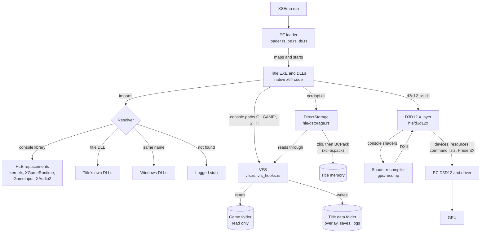
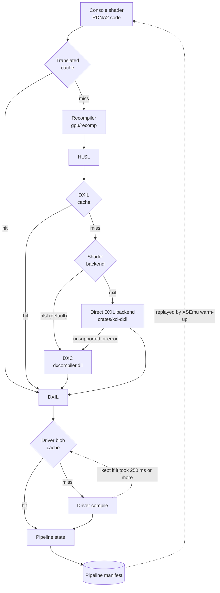
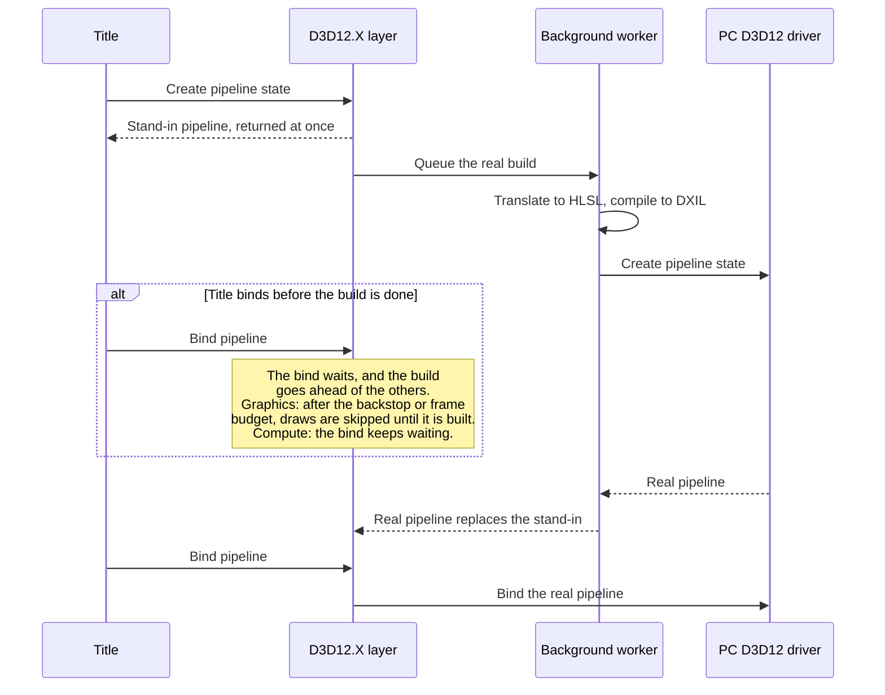

<div align="center">

# XSEmu

**Run Xbox Series X|S (GDK) titles on Windows, built on the XCL translation layer.**

[](LICENSE)
[](Cargo.toml)
[](#requirements)
[](#status)

</div>

XSEmu runs Xbox Series X|S (GDK) titles on Windows x64. It is built on
[XCL](https://github.com/ivall/xcl), a compatibility layer by ivall and its
contributors, and it works the way Wine does: the title's x64 code runs natively
on the host CPU, and XCL stands in for the console libraries that Windows does
not have. XSEmu does not emulate the console's CPU or hardware.

## Contents

- [Status](#status)
- [How it works](#how-it-works)
- [Shader pipeline](#shader-pipeline)
- [Requirements](#requirements)
- [Build and test](#build-and-test)
- [Usage](#usage)
- [Repository layout](#repository-layout)
- [Upstream and licence](#upstream-and-licence)
- [Legal](#legal)

## Status

XSEmu is experimental research software. Expect crashes, missing features and
rendering errors. This repository makes no compatibility claims for any title.
The [upstream README](UPSTREAM.md) records the results that XCL reported; those
are XCL's results, not XSEmu's.

## How it works

`XSEmu run` maps the title's executable and DLLs into its own process and runs
them on the host CPU. Each import goes to an XCL replacement, the title's own
DLL, the Windows DLL of the same name, or a logged stub. Graphics calls go
through a D3D12.X layer that creates real PC D3D12 objects.



- **PE loader and runtime shims.** The loader handles relocations, imports,
  delay-loads, TLS callbacks and exception tables. Console libraries such as
  `kernelx`, XGameRuntime, GameInput and XAudio2 are implemented in
  `crates/xcl/src/hle`. Functions that behave the same as on Windows go to the
  real Windows export.
- **D3D12.X to D3D12.** The console's `d3d12_xs.dll` is replaced by real PC
  D3D12 objects. Console-only device slots, descriptor heaps, command lists and
  `PresentX` are translated to PC D3D12. GFX10 tiled textures are converted to
  PC layouts.
- **DirectStorage.** The console's `xcrdapi.dll` reads files through the VFS and
  decompresses zlib and BCPack data into title memory. BCPack needs a table file
  that is not part of this repository.
- **Virtual file system.** Console paths map to the game folder. The game folder
  is only read: writes, saves and logs go to a per-title data folder.

## Shader pipeline

Console shaders ship as RDNA2 machine code with no usable DXIL. The recompiler
translates each program (vertex, pixel, compute, geometry and mesh/NGG stages)
to HLSL, and a compiler turns that HLSL into DXIL. Three disk caches keep the
work between runs, and a manifest records every pipeline the title made so that
`XSEmu warm-up` can rebuild them before the next run.



- The **translated cache** holds the DXIL of each console program, keyed by the
  program's bytes, its stage, a hash of the translator sources and the DXC
  toolchain. The **DXIL cache** is keyed by the HLSL, the XCL version, the
  compiler identity and the shader profile. A change to the translator or to the
  DXC DLLs gives new keys, so stale entries are not used.
  `XCL_TRANSLATED_CACHE=0` turns off the translated cache.
- The direct DXIL backend compiles only the HLSL dialect that the recompiler
  emits. Anything outside it goes to DXC. DXC and the direct backend never share
  a cache entry.
- The **driver blob cache** lives in `<DXIL cache>\driver\` and is keyed by
  the DXIL hash and flags. A blob is kept when its driver compile took 250 ms
  or more. The driver refuses a blob from another driver, adapter or root
  signature, and XCL then compiles the program again. `XCL_PSO_DISK_CACHE=0` turns it off.
- The **pipeline manifest** lives in `<DXIL cache>\pipelines\`. It keeps the console shaders
  and the pipeline description, not the translation, so a warm-up after a
  translator change builds every pipeline from the new translation.
  `XCL_PSO_MANIFEST=0` turns it off.
- On GPUs that run only 32-lane waves, console wave64 programs run as two
  32-lane halves ([details](docs/wave64-on-wave32.md)).

### Non-blocking pipeline creation

A title creates thousands of pipelines while it loads, and a DXC compile takes
from 0.2 s to several seconds. So when a pipeline's DXIL is not cached yet, the
title gets a stand-in pipeline at once and the real one is built on a
background worker (`hle/d3d12x/pso_async.rs`):



A graphics bind waits at most `XCL_BIND_BACKSTOP_MS` (3000 ms by default). It
doesn't wait at all once the thread's binds have waited
`XCL_FRAME_STALL_BUDGET_MS` (1000 ms by default) since the last present. After
that, draws with the pipeline are skipped until it is built. By default a
compute bind keeps waiting, because a skipped dispatch could leave the title's
state wrong.
`XCL_ASYNC_PSO=0` builds every pipeline inside the create call instead.

## Requirements

- Windows 10 or 11, x64.
- A D3D12 GPU with Shader Model 6.6 and mesh shaders. Without mesh shaders, the
  title's geometry and NGG programs are not drawn. On Windows 10, the inbox
  `D3D12Core.dll` stops at SM 6.5: put the D3D12 Agility SDK in `D3D12\` next
  to `XSEmu.exe`, in `%LOCALAPPDATA%\XCL\D3D12\`, or in `%XCL_D3D12_DIR%`.
- DXC (`dxcompiler.dll` and `dxil.dll`) from the Windows SDK. XCL looks in
  `Windows Kits\10\bin\<version>\x64`, next to `XSEmu.exe`, and in
  `%XCL_DXC_DIR%`. Version 1.8 or newer is recommended.
- Gaming Services, which provides `System32\xgameruntime.dll`. Without it,
  dialogs, text entry, invites and game streaming are missing.
- To build: the Rust MSVC toolchain (`stable-x86_64-pc-windows-msvc`; CI uses
  1.99.0) and the Visual Studio C++ build tools.
- An unpacked copy of a title that you own. See [Legal](#legal).

## Build and test

```powershell
cargo build --release --locked --workspace      # target\release\XSEmu.exe
.\scripts\test.ps1                               # cargo build + cargo test --workspace
```

The test suite builds and runs its own synthetic test title
(`tests/testtitle`, `tests/testgamedll`). GPU tests need a physical D3D12
adapter. When the adapter cannot run a test, the test prints
`SKIPPED <test>: <reason>` and passes. Tests that read real title data are
opt-in through `XCL_SAMPLE_*` variables and are skipped when those variables
are not set.

The direct DXIL backend is a separate workspace with no dependencies and no
Windows code, so you can also build and test it on Linux:

```sh
cargo test --manifest-path crates/xcl-dxil/Cargo.toml
```

## Usage

The executable is `XSEmu.exe` (it was `xcl.exe` before). Run `XSEmu --help` for the full help
text. If you open `XSEmu.exe` from Explorer, a small menu asks for the game's
exe or `MicrosoftGame.config`.

```powershell
XSEmu run <game folder | game.exe> [-- game arguments]   # run a title
XSEmu inspect <file.exe | file.dll> [--json]              # imports and how XCL resolves each
XSEmu disasm <file> [--hex] [--fssm FILE]                 # disassemble RDNA2 and console shader containers
XSEmu shaders <file | folder | package.rpf> [--top N] [--recomp] [--compile N]
XSEmu shaders <file | folder | package.rpf> --precompile [--pipelines]
XSEmu rpf <package.rpf> [--find NAME] [--extract NAME --out DIR]
XSEmu warm-up [--full]
XSEmu warm-up --mesh-only [--recent-used N]
XSEmu warm-up --giants-only --floor-mb N
XSEmu --version
```

| Command | What it does |
|---|---|
| `shaders --precompile` | Translates every VS, PS, MS and CS program in a shader package and compiles it into the DXIL cache, so a title does not wait for DXC on first use. Cached programs are skipped. `--pipelines` also creates each compute pipeline on the GPU, so the driver caches its own compile. |
| `warm-up` | Rebuilds the pipelines in the manifest, so the driver compiles less while a title loads. It stops after 20 minutes (`XCL_WARMUP_BUDGET_S`), leaves out programs over 1 MB of DXIL, and leaves out pipelines that none of the last 3 runs made. |
| `warm-up --full` | Builds everything, with no time limit, and resumes where an earlier `--full` pass stopped. |
| `warm-up --mesh-only` | Builds only the missing driver blobs for mesh pipelines. |
| `warm-up --giants-only --floor-mb N` | Builds the large compute programs one at a time and keeps N MB of RAM free (N must be 1024 or more). |

`warm-up` refuses to start while another `XSEmu.exe` (or an older `xcl.exe`) is running. Run one XCL
process tree at a time.

### Title data and configuration

Each title gets a data folder at `%LOCALAPPDATA%\XCL\<title>\` (or
`%XCL_DATA_ROOT%\<title>\`). It holds `xcl.toml`, the write overlay, saves,
the title's `S:\` and `T:\` storage, caches, `logs\xcl.log` and
`logs\report.json`. The report lists called stubs, unknown D3D12.X slots,
shader statistics and the crash, if there was one.

In `xcl.toml`, `device_type = "lockhart"` makes the title see a Series S; the
default, `"anaconda"`, is a Series X.

<details>
<summary><strong>Environment variables</strong></summary>

| Variable | Effect |
|---|---|
| `XCL_DATA_ROOT` | Root folder for per-title data, instead of `%LOCALAPPDATA%\XCL`. |
| `XCL_DXC_DIR` | Folder that holds `dxcompiler.dll` and `dxil.dll`. |
| `XCL_D3D12_DIR` | Folder that holds the D3D12 Agility SDK. |
| `XCL_ADAPTER` | GPU to use, by index (`1`) or by name (`radeon`). |
| `XCL_SHADER_BACKEND` | `hlsl` (default) compiles with DXC. `dxil` uses the direct DXIL backend, with DXC as the fallback. |
| `XCL_DXIL_CACHE` | Folder of the DXIL cache, instead of `%LOCALAPPDATA%\xcl\dxil`. |
| `XCL_TRANSLATED_CACHE=0` | Turns off the disk cache of translated shaders. |
| `XCL_PSO_DISK_CACHE=0` | Turns off the driver blob cache. |
| `XCL_PSO_MANIFEST=0` | Stops recording pipelines in the manifest. |
| `XCL_ASYNC_PSO=0` | Builds every pipeline inside the create call, with no stand-in. |
| `XCL_FRAME_INTERVAL_US` | Frame interval in µs that the frame clock uses instead of the title's, for example `16667` (60 fps) for a title that asks for 33333 (30 fps). `8333` (120 fps) works only on a display of 120 Hz or more. `0` uses the title's interval. Overrides `frame_interval_us` in `xcl.toml`. |
| `XCL_WARMUP_BUDGET_S` | Time limit in seconds for `XSEmu warm-up` without `--full`. |
| `XCL_NETWORK=0` | Runs the title with no network, as on a console that is offline. Loopback still works. |
| `XCL_STORE=offline-error` | Every store query fails with the GDK store network error. No licence is granted. |
| `XCL_BCPACK_TABLES` | Path to the BCPack table file. The file is not part of this repository; without it, BCPack requests fail. |
| `XCL_D3D12_DEBUG` | Turns on the D3D12 debug layer. |
| `XCL_REQUIRE_GPU` | In tests, `wave64`, `mesh` or `wave64,mesh` makes skipped GPU tests fail. |

The code reads many more `XCL_*` variables for tracing and diagnostics. See the
source for those.

</details>

## Repository layout

| Path | Contents |
|---|---|
| `crates/xcl` | The translation layer and `XSEmu.exe`: PE loader, VFS, launcher and CLI. |
| `crates/xcl/src/hle` | Console library replacements: `kernelx`, `xgameruntime`, `d3d12x` (D3D12.X), `dstorage`, `xaudio2`, `xma2`, `gameinput`, `bink` and others. |
| `crates/xcl/src/gpu` | RDNA2 decoder, console shader containers, texture tiling and adapter selection. |
| `crates/xcl/src/gpu/recomp` | RDNA2 to HLSL recompiler, DXC driver and pipeline building. |
| `crates/xcl-dxil` | Direct DXIL backend, with the `xdxc` and `xdiff` tools. |
| `crates/xcl-bcpack` | BCPack decoder. |
| `tests/` | Synthetic test title, test DLL and test data. |
| `scripts/` | Test scripts and the generators for the tables in `crates/xcl/src/gpu`. |
| `docs/` | Design notes: [design spec](docs/specs/2026-11-20-xcl-design.md), [mesh shaders](docs/mesh-shaders.md), [wave64 on wave32](docs/wave64-on-wave32.md). |
| `depth-uav-probe/` | Standalone D3D12 depth UAV probe. |

`HANDOFF.md`, `CONTRIBUTING.md` and `UPSTREAM.md` come from upstream XCL.

## Upstream and licence

XSEmu started from
[XCL at `f311ca5`](https://github.com/ivall/xcl/tree/f311ca5b969ce2e7303495ccd12c1eed74668383)
and merges general fixes from XCL's `main`. Credit for the loader, the runtime
shims, the recompiler and the test suite goes to ivall and the XCL contributors.

XSEmu is licensed under [GPL-2.0-only](LICENSE), the same as XCL. Third-party
sources and their licences are listed in [THIRD_PARTY.md](THIRD_PARTY.md). Code
ported from another project carries a provenance note in the file.

## Legal

XSEmu is not affiliated with or endorsed by Microsoft or AMD. Xbox is a
trademark of Microsoft.

- This repository contains no game files, console firmware, SDK headers or
  binaries, keys, or dumps. Do not commit or share any of them.
- Use XSEmu only with titles that you own and have unpacked yourself.
- XSEmu does not decrypt packages and does not bypass DRM.
- Title code runs natively on your PC, and the virtual file system is not a
  security sandbox. Run only titles you trust.
